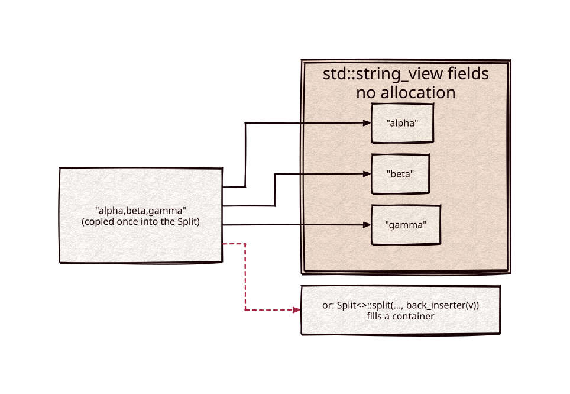

# split

Part of [Kronuz C++ Libraries](https://github.com/Kronuz/cpp-libraries), a collection of small, reusable C++ libraries.

[](https://github.com/Kronuz/split/actions/workflows/ci.yml)
[](LICENSE)


A tiny string splitter for C++17: iterate the fields of a string as
`std::string_view`s without allocating, or fill a container in one call.



## ✨ Highlights

- **Zero-copy iteration.** Fields are `std::string_view`s into the splitter's
  copy of the source.
- **One-call collection.** Static helpers write fields into any output iterator.
- **Two modes.** Split on a whole delimiter string (`"::"`) or on any character
  of a set (`",;"`).
- **Blank fields your way.** Empty fields are dropped by default, or kept.
- **One header, no dependencies.**

## 📦 Installation

Requires a C++17 compiler; CMake 3.14 or newer for the CMake route. CI builds it
on Linux (x86_64, arm64), macOS (arm64, x86_64), and FreeBSD, plus ASan, UBSan,
and TSan builds.

```cmake
include(FetchContent)
FetchContent_Declare(split
  GIT_REPOSITORY https://github.com/Kronuz/split.git
  GIT_TAG        main)
FetchContent_MakeAvailable(split)

target_link_libraries(my_app PRIVATE split::split)
```

Or copy `split.h` onto your include path.

## 🚀 Quick start

```cpp
#include "split.h"

#include <iterator>
#include <string>
#include <vector>

int main() {
	Split<> path(std::string("usr/local/bin"), '/');
	for (std::string_view part : path) { /* "usr", "local", "bin" */ }

	std::vector<std::string> words;
	Split<>::split_first_of(std::string("a,b;c"), std::string(",;"), std::back_inserter(words));
	// words == {"a", "b", "c"}
}
```

[`examples/demo.cc`](examples/demo.cc) contrasts the two modes, blank fields, and
joining with the iterator's `last()`.

## 🎯 When to use it

- ✅ Splitting delimited text: paths, CSV-like fields, key lists.
- ❌ Regular expressions, locale-aware tokenizing, or input that is not one
  contiguous string.

## ⚡ Performance

`Split` does one search per field (`find` or `find_first_of` on the source), allocates nothing in iteration
and takes `std::string_view` sources by view. `bench/compare.cc` measures it against hand-written loops
and `absl::StrSplit` on comma-separated text of 1 to 15 character fields, one in ten of them empty:

```sh
cmake -B build -DCMAKE_BUILD_TYPE=Release -DSPLIT_BUILD_BENCH=ON && cmake --build build && ./build/split_compare
```

Both sides return the same fields (checked before each row is timed; `--check` runs only the checks). The
hand loop is `memchr` for a character, `string_view::find` for `"::"` and `find_first_of` for `",;"`.
Time per call, `-O3`, Apple clang 17, abseil 20260817.0, the best of seven samples, on an Apple M4 Pro and an
Intel i9-9980HK:

| workload | M4 Pro: `Split` / hand loop / absl | i9-9980HK: `Split` / hand loop / absl |
|---|---:|---:|
| `split()` on `,` into a vector, 64 B | 75 / 80 / 62 ns | 228 / 223 / 129 ns |
| `split()` on `,`, 1 KB | 812 / 819 / 989 ns | 1.22 / 1.20 / 1.53 us |
| `split()` on `,`, 64 KB | 54.8 / 56.0 / 75.1 us | 68.1 / 62.1 / 89.0 us |
| `split()` on `"::"`, 1 KB | 910 / 897 / 1,256 ns | 1.66 / 1.60 / 2.11 us |
| `split_first_of()` on `,;`, 1 KB | 908 / 1,046 / 972 ns | 1.80 / 1.91 / 2.43 us |
| `Split<std::string_view>` iterator, 1 KB | 726 / 745 / 909 ns | 1.12 / 0.80 / 1.08 us |
| `Split<std::string_view>` iterator, 64 KB | 52.3 / 55.1 / 75.3 us | 81.3 / 55.4 / 73.9 us |
| `Split<std::string>` iterator, 1 KB | 1,007 / 745 / 912 ns | 1.49 / 0.80 / 1.08 us |

The one-call helpers are level with the hand loop and, from 1 KB up, 1.1x to 1.4x faster than `absl::StrSplit`
(0.7x to 0.9x of its time); `absl::StrSplit` is ahead on 64 bytes (1.2x on the M4 Pro, 1.7x on the i9). The
iterator keeps a look-ahead position, so it costs 1.0x of a hand loop on the M4 Pro and 1.4x to 1.5x on the
i9. `Split<std::string>` copies its source: 1.3x to 1.4x the time of the view form at 1 KB, 1.9x at 64 bytes.

## 📚 Documentation

- [docs/API.md](docs/API.md): constructors, the four modes, iterators, the static
  helpers, and caveats (including the counterintuitive `SKIP_BLANK_*` names).
- [ARCHITECTURE.md](ARCHITECTURE.md): how the search dispatch and the iterator
  work.
- [AGENTS.md](AGENTS.md): repository map and traps.

## 🛠️ Building and testing

```sh
cmake -B build && cmake --build build && ctest --test-dir build
./build/split_demo
```

## 🤝 Contributing

Issues and pull requests are welcome. Read [AGENTS.md](AGENTS.md) first. CI must
pass on every platform.

## 📄 License

MIT, Copyright (c) 2015-2019 Dubalu LLC. See [LICENSE](LICENSE). Extracted from
[Xapiand](https://github.com/Kronuz/Xapiand).
