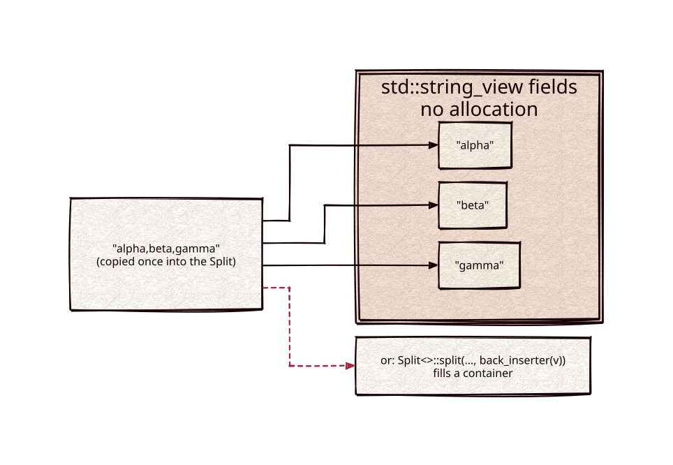

# split

[](https://github.com/Kronuz/split/actions/workflows/ci.yml)
[](LICENSE)


A tiny string splitter for C++17: iterate the fields of a string as
`std::string_view`s without allocating, or fill a container in one call.



## ✨ Highlights

- **Zero-copy iteration.** Fields are `std::string_view`s into the splitter's
  copy of the source.
- **One-call collection.** Static helpers write fields into any output iterator.
- **Two modes.** Split on a whole delimiter string (`"::"`) or on any character
  of a set (`",;"`).
- **Blank fields your way.** Empty fields are dropped by default, or kept.
- **One header, no dependencies.**

## 📦 Installation

Requires a C++17 compiler; CMake 3.14 or newer for the CMake route. CI builds it
on Linux (x86_64, arm64), macOS (arm64, x86_64), and FreeBSD, plus ASan, UBSan,
and TSan builds.

```cmake
include(FetchContent)
FetchContent_Declare(split
  GIT_REPOSITORY https://github.com/Kronuz/split.git
  GIT_TAG        main)
FetchContent_MakeAvailable(split)

target_link_libraries(my_app PRIVATE split::split)
```

Or copy `split.h` onto your include path.

## 🚀 Quick start

```cpp
#include "split.h"

#include <iterator>
#include <string>
#include <vector>

int main() {
	Split<> path(std::string("usr/local/bin"), '/');
	for (std::string_view part : path) { /* "usr", "local", "bin" */ }

	std::vector<std::string> words;
	Split<>::split_first_of(std::string("a,b;c"), std::string(",;"), std::back_inserter(words));
	// words == {"a", "b", "c"}
}
```

[`examples/demo.cc`](examples/demo.cc) contrasts the two modes, blank fields, and
joining with the iterator's `last()`.

## 🎯 When to use it

- ✅ Splitting delimited text: paths, CSV-like fields, key lists.
- ❌ Regular expressions, locale-aware tokenizing, or input that is not one
  contiguous string.

## 📚 Documentation

- [docs/API.md](docs/API.md): constructors, the four modes, iterators, the static
  helpers, and caveats (including the counterintuitive `SKIP_BLANK_*` names).
- [ARCHITECTURE.md](ARCHITECTURE.md): how the search dispatch and the iterator
  work.
- [AGENTS.md](AGENTS.md): repository map and traps.

## 🛠️ Building and testing

```sh
cmake -B build && cmake --build build && ctest --test-dir build
./build/split_demo
```

## 🤝 Contributing

Issues and pull requests are welcome. Read [AGENTS.md](AGENTS.md) first. CI must
pass on every platform.

## 📄 License

MIT, Copyright (c) 2015-2019 Dubalu LLC. See [LICENSE](LICENSE). Extracted from
[Xapiand](https://github.com/Kronuz/Xapiand).
